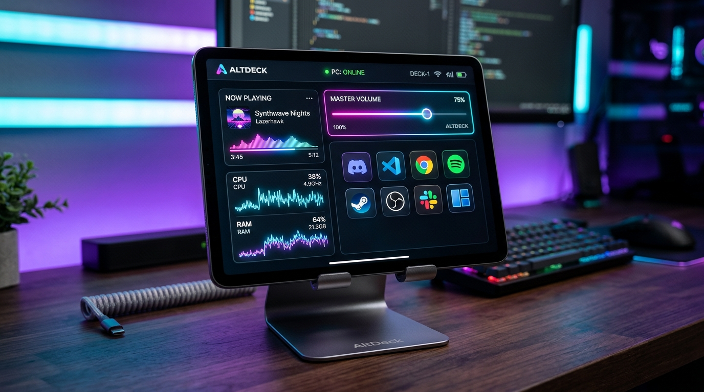
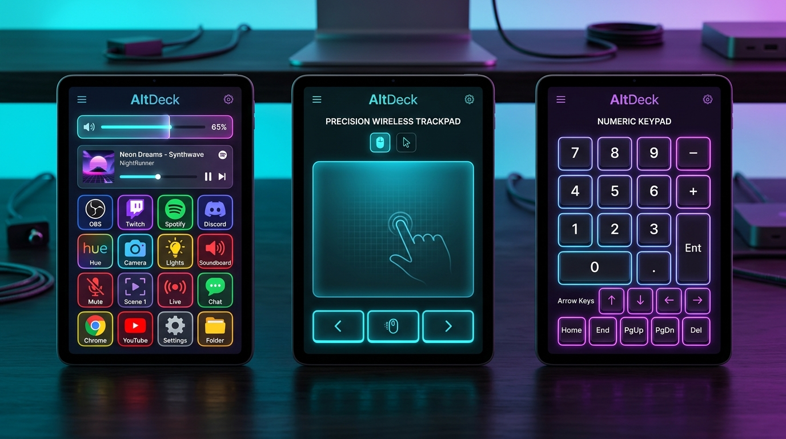

# AltDeck PC Controller 🎛️⚡

<p align="center">
  
</p>

<p align="center">
  <strong>Transform any Android tablet, iPad, or smartphone into a zero-latency, hardware-accelerated Stream Deck & PC Controller.</strong>
</p>

<p align="center">
  <a href="#license"></a>
  <a href="https://nodejs.org"></a>
  <a href="https://microsoft.com/windows"></a>
  
  
  
</p>

<p align="center">
  <a href="https://anass-gouzgar.github.io/altdeck/">
    
  </a>
</p>

<p align="center">
  
</p>

---

## 🌟 Why AltDeck?

Most Stream Deck alternatives either require installing proprietary APKs on your tablet, have sluggish HTTP lag, or cannot control low-level Windows hardware settings (like true master audio endpoints and monitor brightness).

**AltDeck** takes an entirely different approach:
- **Zero App Installation on Tablet**: Works instantly inside any modern mobile browser (Chrome, Samsung Internet, Edge, Safari). Add to Home Screen as a standalone PWA.
- **Sub-10ms Hardware Latency**: Communicates over binary/JSON WebSockets directly with a high-performance native C# companion that taps into Windows CoreAudio COM (`IAudioEndpointVolume`) and WMI.
- **Universal Tablet Keep-Awake**: Built-in `NoSleep.js` fallback keeps your tablet screen awake 24/7 on local Wi-Fi without requiring HTTPS certificates.
- **Zero-Void Responsive Multi-Device UI**: Mathematically balanced layouts that fill 100% of the screen with zero dead spaces on iPads, Android tablets (portrait & landscape), smartphones, laptops, standard desktop monitors, and 4K ultrawide displays.
- **5-in-1 Workspace**: Stream Deck + Wireless Touchpad Pro + PC Numpad & Navigation + AirDrop File Drop + Safe Power Center.
- **Custom Actions & Macros**: Create interactive buttons to open URLs, run terminal commands, or copy text directly to your PC clipboard.
- **Real-Time PC-to-Tablet Notifications**: Stream build alerts, dev notifications, and task status from PC to tablet with pleasant audio chimes.
- **14 Curated Luxury Themes & Trilingual i18n**: 14 Cyberpunk/OLED glassmorphic themes; English, Français, and Arabic (العربية) with native RTL layout.

---

## 📸 Features at a Glance

<p align="center">
  
</p>

### 1. 🎛️ Master Hardware & Media Deck
- **Master Audio Endpoint**: 0-100% smooth slider, one-tap instant mute with neon status indicator, and quick presets (25%, 50%, 75%, 100%).
- **🎙️ Global Microphone Mute with Live "ON-AIR" Glow**: Low-level Windows CoreAudio endpoint capture toggle with real-time pulsing status.
- **🎵 WinRT Media Player & Live Track Timeline**: Real-time track title, artist name, and album title from Spotify, YouTube (Chrome/Edge), spinning vinyl disc animation, 4-bar equalizer, and an interactive draggable timeline scrubber with seek support.
- **Media Controls**: Previous, Play/Pause, and Next track using hardware extended scan codes.
- **16-App Instant Launchpad**: Launch top desktop apps with official high-resolution branding (Discord, Claude AI, 3uTools, Google Chrome, Microsoft Edge, VS Code, Antigravity AI IDE, File Explorer, Sticky Notes, Windows Settings, Microsoft Word, Microsoft Excel, Microsoft PowerPoint, Microsoft Outlook, Paint, and Windows Terminal).
- **Auto-Detected Installed PC Apps**: Automatic scanner detecting installed Windows apps with search filter and one-tap "+ Add to Deck" shortcut button creation.
- **⚡ Custom Actions & Macros Studio**: Create interactive buttons to launch apps, open URLs, copy text to PC clipboard, or run terminal commands.

### 2. 💡 Display & Quick System Toggles Deck
- **Hardware Display Brightness**: Direct WMI screen brightness slider (0-100%) and quick presets (20%, 50%, 80%, 100%).
- **🖥️ Screen Off Mode (Without Sleep)**: Instantly turn off your PC/laptop monitors with one tap while keeping background renders, music, and downloads active. Wake instantly by touching the tablet trackpad or the floating status banner.
- **Project Display**: One-tap trigger for the Windows Project flyout (`Win + P`) to switch monitor mirroring or extension.
- **Night Light**: Instant access to Windows blue-light warmth settings.
- **Bluetooth & Wi-Fi Settings**: Rapid launch of Windows wireless connection panels.
- **Quick Calculator & Xbox Game Bar**: One-tap launch for Windows Calculator and Xbox Game Bar (`Win + G`).
- **Windows Settings**: One-tap shortcut to Windows Control Settings (`Win + I`).

### 3. 🪟 Windows Snap Layouts & Multi-Screen Window Management
- **Snap Layouts (4 Tiles)**: Snap active window to Left Half (`Win + Left`), Right Half (`Win + Right`), Maximize (`Win + Up`), Minimize (`Win + Down`).
- **Multi-Monitor Display Moving**: Move active window across physical screens (`Win + Shift + Left/Right`).
- **Virtual Desktops**: Switch virtual desktops (`Win + Ctrl + Left/Right`) and create new desktops on the fly.
- **System Shortcuts**: Alt+Tab app switcher, Task View (`Win + Tab`), Desktop toggle (`Win + D`), Windows Snipping Tool (`Win + Shift + S`), and Close Active Window (`Alt + F4`).

### 4. 📊 Live PC Hardware Telemetry & Top Process Killer
- **CPU Processor**: Real-time load % with dynamic color shift (Cyan `<60%` → Amber → Red `>85%`) and active core count.
- **RAM Memory**: Real-time memory usage breakdown (`14.6 GB / 31.8 GB • 17.2 GB Free`) with progress gauge.
- **Power & Battery**: Live state detection (`⚡ AC Plugged In` vs `🔋 Running on Battery`) and battery % level.
- **Real-Time Load Waveform Sparkline**: 60-second real-time SVG load graph inside the Telemetry card for CPU (Cyan) and RAM (Purple).
- **📋 Top Resource Apps Scanner & Instant Killer**: Scans active Windows processes, lists top RAM-consuming applications (`chrome.exe`, `Code.exe`, etc.) in MB, and allows one-tap termination with the red **[Kill]** button.
- **Header Live Stat Pills**: CPU %, RAM %, and Battery % always visible in the top navigation bar.

### 5. 🖱️ Wireless Precision Trackpad Pro Companion
- **Multi-Touch Trackpad Surface**: Converts tablet into a precision touchpad with left-click, middle-click, right-click, smooth pointer motion, and two-finger scrolling.
- **Pointer Sensitivity Presets**: 4 hardware speed profiles (`Slow 0.6x`, `Normal 1.0x`, `Fast 1.5x`, `Turbo 2.2x`).
- **Double-Click & Drag Lock**: Dedicated hardware double-click action and drag & drop toggle.
- **Remote Scroll Wheel**: Directional remote scroll buttons (Scroll Up, Scroll Down, Scroll Left, Scroll Right).
- **Interactive Gesture Guide**: Built-in visual reference for multi-touch gestures.

### 6. ⌨️ Wireless PC Numpad & Remote Extended Navigation
- **4x4 Accounting Numpad**: Full numeric keypad with arithmetic operators (`÷`, `×`, `−`, `+`), numbers `0-9`, `Enter`, `Backspace`, `Tab`, `Esc` with tactile sound and haptic click response.
- **Remote PC Typing Bar**: Type any text on your tablet and inject it directly into the active PC cursor/window.
- **Extended Windows Navigation Cluster**: Hardware Directional Arrow Keys (`↑`, `↓`, `←`, `→`), Page Up, Page Down, Home, End, and Windows Function Keys (`F2`, `F5`, `F11`, `F12`).

### 7. ⚡ Safe Power Management & Emergency Diagnostics
- **Lock Workstation & Low-Power Sleep**: Instant `Win + L` lock and system sleep.
- **Safe Restart & Shutdown with 30-Second Countdown**: Protected with a visual safety countdown modal and instant **CANCEL NOW** (`shutdown /a`) override.
- **🚨 Emergency Windows Explorer Restart**: One-tap recovery that restarts `explorer.exe` to restore frozen taskbars, start menus, or desktop icons.
- **🎧 Emergency Audio Driver Reset**: Restarts the Windows Audio service (`Restart-Service Audiosrv`) if sound is frozen without requiring a PC reboot.

### 8. 📂 AltDeck Beam — Quick File Drop (AirDrop for PC)
- **Local Wi-Fi File Streaming**: Beam photos, screenshots, documents, and videos from your tablet straight into your PC's `Desktop/AltDeck Transfers` folder.
- **Drag & Drop & Tablet Camera**: Tap to pick files or snap photos directly with your tablet camera.
- **Live Upload Progress**: Real-time progress bar with upload percentage.
- **Auto PC Notification & Folder Launcher**: Plays a synthesized chime upon arrival and features an instant **"📂 Open Folder on PC"** button.

### 9. 🔔 Real-Time PC-to-Tablet Notifications
- Push alerts from command line, build scripts, or terminal:
  ```bash
  npm run notify -- "Build Complete" "All test suites passed!" success
  ```
- Or via HTTP:
  ```bash
  curl -X POST http://localhost:3000/api/notify -H "Content-Type: application/json" -d "{\"title\":\"Done\",\"level\":\"success\"}"
  ```
- Instant sliding glass banner on tablet screen + Web Audio synth chime + notification history drawer.

### 10. 🎨 14 Luxury Cyber Themes & Multi-Language (i18n)
- **14 Cyberpunk/Glassmorphic Themes**: Obsidian Dark, Midnight OLED, Ocean Deep, Ember Orange, Emerald Forest, Cyber Rose, Frost Aurora, Royal Gold, Cyberpunk 2077, Matrix Code, Synthwave 80s, Dracula Purple, Crimson Red, Nord Arctic.
- **Trilingual Language Audit (100% Dynamic Translation)**: English, Français, and Arabic (`العربية`) across every card, badge, button, placeholder, countdown modal, and real-time toast notification.
- **Native Arabic RTL & Typography**: Full `[dir="rtl"]` layout with Cairo typography, while strictly preserving Left-to-Right orientation on hardware sliders and numpad.
- **🕒 Strict 24-Hour Military Time**: Top clock strictly formatted in 24-hour mode (`HH:mm`, e.g. `23:30`) with PC timezone auto-sync.

---

## 🚀 Quick Start

### 1. Clone & Run on PC
```bash
# Clone the repository
git clone https://github.com/anass-gouzgar/altdeck.git
cd altdeck

# Install dependencies
npm install

# Start AltDeck
npm start
```
*(Windows users can also simply double-click **`start-controller.bat`**)*

AltDeck will automatically compile the native Windows hardware controller (`bin/pc-control.exe`) on its very first launch—no manual compiler setup required!

### 2. Connect Your Tablet
1. Make sure your tablet is connected to the same Wi-Fi network as your PC.
2. Open Chrome, Edge, or Samsung Internet on the tablet and enter the address shown in your terminal:
   ```text
   http://<YOUR-PC-IP>:3000
   ```
   *(Or scan the QR code displayed on your PC screen at `http://localhost:3000`)*

### 3. Install as a Fullscreen App (PWA)
On Android (Chrome / Samsung Internet):
1. Tap the **three dots menu (⋮)** in the browser.
2. Select **"Add to Home screen"** or **"Install app"**.
3. Launch AltDeck from your home screen for a borderless, native desktop-feel experience!

---

## ⚙️ Configuration & Custom Apps

You can easily customize ports or add your own custom app buttons without editing code!

1. Copy `config.example.json` to `config.json`:
   ```bash
   cp config.example.json config.json
   ```

2. Add custom apps, commands, or websites:
   ```json
   {
     "port": 3000,
     "customApps": {
       "spotify": {
         "name": "Spotify",
         "category": "Media",
         "color": "#1DB954",
         "command": "start spotify:"
       },
       "terminal": {
         "name": "Windows Terminal",
         "category": "Development",
         "color": "#4D4D4D",
         "command": "start wt.exe"
       },
       "github": {
         "name": "GitHub",
         "category": "Web",
         "color": "#F0F6FC",
         "url": "https://github.com"
       }
     }
   }
   ```

---

## 🏗️ Technical Architecture

```text
┌──────────────────────────────────────────────┐
│  Android Tablet / iPad / Phone               │
│  - Obsidian Cyber-Glassmorphism UI           │
│  - NoSleep.js WakeLock Engine                │
│  - Touchpad Multi-touch Listeners            │
└──────────────────────┬───────────────────────┘
                       │ WebSocket (port 3000)
                       ▼
┌──────────────────────────────────────────────┐
│  Node.js Server (server.js)                  │
│  - HTTP static server & REST API             │
│  - WebSocket client broadcaster              │
│  - Dynamic app launcher (app-launcher.js)    │
└──────────────────────┬───────────────────────┘
                       │ Fast Subprocess Execution (<10ms)
                       ▼
┌──────────────────────────────────────────────┐
│  Native C# Core (bin/pc-control.exe)         │
│  - IAudioEndpointVolume (CoreAudio COM)      │
│  - WmiMonitorBrightness Methods              │
│  - SendInput Hardware ScanCodes (user32.dll) │
└──────────────────────────────────────────────┘
```

---

## 🤝 Contributing

We love contributions! Whether you want to add support for OBS Studio, Spotify Web API now-playing metadata, new themes, or Linux/macOS companion agents, please check out our [CONTRIBUTING.md](CONTRIBUTING.md).

1. Fork the Project
2. Create your Feature Branch (`git checkout -b feature/AmazingFeature`)
3. Commit your Changes (`git commit -m 'feat: add amazing feature'`)
4. Push to the Branch (`git push origin feature/AmazingFeature`)
5. Open a Pull Request

---

## 📄 License

Distributed under the MIT License. See [LICENSE](LICENSE) for more information.

---

<p align="center">
  Crafted with ❤️ for makers, gamers, and productivity power users.
</p>
