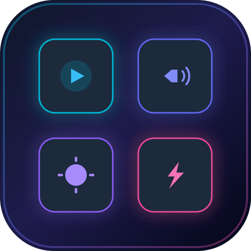

# AltDeck PC Controller 🎛️⚡

<p align="center">
  
</p>

<p align="center">
  <strong>Transform any Android tablet, iPad, or smartphone into a zero-latency, hardware-accelerated Stream Deck & PC Controller.</strong>
</p>

<p align="center">
  <a href="#license"></a>
  <a href="https://nodejs.org"></a>
  <a href="https://microsoft.com/windows"></a>
  
  
</p>

---

## 🌟 Why AltDeck?

Most Stream Deck alternatives either require installing proprietary APKs on your tablet, have sluggish HTTP lag, or cannot control low-level Windows hardware settings (like true master audio endpoints and monitor brightness).

**AltDeck** takes an entirely different approach:
- **Zero App Installation on Tablet**: Works instantly inside any modern mobile browser (Chrome, Samsung Internet, Edge, Safari). Add to Home Screen as a standalone PWA.
- **Sub-10ms Hardware Latency**: Communicates over binary/JSON WebSockets directly with a high-performance native C# companion that taps into Windows CoreAudio COM (`IAudioEndpointVolume`) and WMI.
- **Universal Tablet Keep-Awake**: Built-in `NoSleep.js` fallback keeps your tablet screen awake 24/7 on local Wi-Fi without requiring HTTPS certificates.
- **4-in-1 Workspace**: Stream Deck + Wireless Touchpad + PC Numpad + Safe Power Center.
- **Custom Actions & Macros**: Create interactive buttons to open URLs, run terminal commands, or copy text directly to your PC clipboard.
- **Real-Time PC-to-Tablet Notifications**: Stream build alerts, dev notifications, and task status from PC to tablet with pleasant audio chimes.
- **14 Curated Luxury Themes & Trilingual i18n**: 14 Cyberpunk/OLED glassmorphic themes; English, Français, and Arabic (العربية) with native RTL layout.

---

## 📸 Features at a Glance

### 1. 🎛️ Master Hardware & Media Deck
- **Master Audio Endpoint**: 0-100% smooth slider, one-tap instant mute with neon status indicator, and quick presets (25%, 50%, 75%, 100%).
- **Hardware Display Brightness**: Direct WMI screen brightness slider (0-100%) and quick presets (20%, 50%, 80%, 100%).
- **🎙️ Global Microphone Mute with Live "ON-AIR" Glow**: Low-level Windows CoreAudio endpoint capture toggle with real-time pulsing status.
- **🎵 WinRT Media Player & Live Track Timeline**: Real-time track title, artist name, and album title from Spotify, YouTube (Chrome/Edge), spinning vinyl disc animation, 4-bar equalizer, and an interactive draggable timeline scrubber with seek support.
- **Media Controls**: Previous, Play/Pause, and Next track using hardware extended scan codes.
- **One-Tap App Launchpad**: Launch tools with official vector branding (Discord, Claude AI, 3uTools, Chrome, Edge, VS Code, Antigravity IDE, File Explorer, Sticky Notes, Windows Settings).
- **Auto-Detected Installed PC Apps**: Automatic scanner detecting installed Windows apps with search filter and one-tap "+ Add to Deck" shortcut button creation.
- **⚡ Custom Actions & Macros Studio**: Create interactive buttons to launch apps, open URLs, copy text to PC clipboard, or run terminal commands.

### 2. 🪟 Windows Snap Layouts & Multi-Screen Window Management
- **Snap Layouts (4 Tiles)**: Snap active window to Left Half (`Win + Left`), Right Half (`Win + Right`), Maximize (`Win + Up`), Minimize (`Win + Down`).
- **Multi-Monitor Display Moving**: Move active window across physical screens (`Win + Shift + Left/Right`).
- **Virtual Desktops**: Switch virtual desktops (`Win + Ctrl + Left/Right`) and create new desktops on the fly.
- **System Shortcuts**: Alt+Tab app switcher, Task View (`Win + Tab`), Desktop toggle (`Win + D`), Windows Snipping Tool (`Win + Shift + S`), and Close Active Window (`Alt + F4`).

### 3. 📊 Live PC Hardware Telemetry Gauges
- **CPU Processor**: Real-time load % with dynamic color shift (Cyan `<60%` → Amber → Red `>85%`) and active core count.
- **RAM Memory**: Real-time memory usage breakdown (`14.6 GB / 31.8 GB • 17.2 GB Free`) with progress gauge.
- **Power & Battery**: Live state detection (`⚡ AC Plugged In` vs `🔋 Running on Battery`) and battery % level.
- **Header Live Stat Pills**: CPU %, RAM %, and Battery % always visible in the top navigation bar.
- **Task Manager Launcher**: One-tap button on the telemetry card to launch Windows Task Manager on PC.

### 4. 🕒 Strict 24-Hour Military Time & Timezone Offset Correction
- Top clock strictly formatted in 24-hour mode (`HH:mm`, e.g. `23:30`) independent of tablet browser locale.
- Auto-synchronization with PC hardware timezone offset (`pcTzOffset`).
- Interactive timezone offset adjuster in Config tab (`[-1h]`, `[PC Sync]`, `[+1h]`) saved to tablet storage.

### 5. 🔔 Real-Time PC-to-Tablet Notifications
- Push alerts from command line, build scripts, or terminal:
  ```bash
  npm run notify -- "Build Complete" "All test suites passed!" success
  ```
- Or via HTTP:
  ```bash
  curl -X POST http://localhost:3000/api/notify -H "Content-Type: application/json" -d "{\"title\":\"Done\",\"level\":\"success\"}"
  ```
- Instant sliding glass banner on tablet screen + Web Audio synth chime + notification history drawer.

### 6. 🎨 14 Luxury Cyber Themes & Multi-Language (i18n)
- **14 Cyberpunk/Glassmorphic Themes**: Obsidian Dark, Midnight OLED, Ocean Deep, Ember Orange, Emerald Forest, Cyber Rose, Frost Aurora, Royal Gold, Cyberpunk 2077, Matrix Code, Synthwave 80s, Dracula Purple, Crimson Red, Nord Arctic.
- **Trilingual Language Audit (100% Dynamic Translation)**: English, Français, and Arabic (`العربية`) across every card, badge, button, placeholder, countdown modal, and real-time toast notification.
- **Native Arabic RTL & Typography**: Full `[dir="rtl"]` layout with Cairo typography, while strictly preserving Left-to-Right orientation on hardware sliders and numpad.

### 7. 🖱️ Wireless Trackpad & Numpad Modes
- **Multi-Touch Trackpad**: Converts tablet into a touchpad with left-click, right-click, smooth pointer motion, and two-finger vertical scrolling.
- **Wireless PC Numpad**: Full numeric keypad with arithmetic operators (`÷`, `×`, `−`, `+`), numbers `0-9`, `Enter`, `Backspace`, `Tab`, `Esc`, plus a **Remote PC Typing bar** to stream text straight into the active PC window.

### 8. ⚡ Safe Power Management & Screen Off
- **🖥️ Screen Off Mode (Without Sleep)**: Instantly turn off your PC/laptop monitors with one tap while keeping background renders, music, and downloads active. Wake instantly by touching the tablet trackpad or the floating status banner.
- Lock workstation (`Win + L`) and low-power Sleep.
- Safe Restart & Shutdown with a **30-second emergency countdown modal** and an instant **CANCEL NOW** (`shutdown /a`) button.

### 9. 📂 AltDeck Beam — Quick File Drop (AirDrop Alternative)
- **Local Wi-Fi File Streaming**: Beam photos, screenshots, and files from your tablet straight into your PC's `Desktop/AltDeck Transfers` folder.
- **Drag & Drop & Tablet Camera**: Tap to pick files or snap photos directly with your tablet camera.
- **Live Upload Progress**: Real-time progress bar with upload percentage.
- **Auto PC Notification & Folder Launcher**: Plays a synthesized chime upon arrival and features an instant **"📂 Open Folder on PC"** button.

### 10. 📋 Top Resource Apps & Live Waveform Sparklines (Task Manager Deck)
- **Real-Time Load Waveform**: Live 60-second animated SVG load graph inside the Telemetry card for CPU (Cyan) and RAM (Purple).
- **Active Process Scanner**: Scans active Windows processes and displays the top 5 memory-heavy applications (`chrome.exe`, `Code.exe`, etc.) with their RAM in MB.
- **Instant Kill**: Terminate hung or heavy applications with a single tap of the red **[Kill]** button.

---

## 🚀 Quick Start

### 1. Clone & Run on PC
```bash
# Clone the repository
git clone https://github.com/anass-gouzgar/altdeck.git
cd altdeck

# Install dependencies
npm install

# Start AltDeck
npm start
```
*(Windows users can also simply double-click **`start-controller.bat`**)*

AltDeck will automatically compile the native Windows hardware controller (`bin/pc-control.exe`) on its very first launch—no manual compiler setup required!

### 2. Connect Your Tablet
1. Make sure your tablet is connected to the same Wi-Fi network as your PC.
2. Open Chrome, Edge, or Samsung Internet on the tablet and enter the address shown in your terminal:
   ```text
   http://<YOUR-PC-IP>:3000
   ```
   *(Or scan the QR code displayed on your PC screen at `http://localhost:3000`)*

### 3. Install as a Fullscreen App (PWA)
On Android (Chrome / Samsung Internet):
1. Tap the **three dots menu (⋮)** in the browser.
2. Select **"Add to Home screen"** or **"Install app"**.
3. Launch AltDeck from your home screen for a borderless, native desktop-feel experience!

---

## ⚙️ Configuration & Custom Apps

You can easily customize ports or add your own custom app buttons without editing code!

1. Copy `config.example.json` to `config.json`:
   ```bash
   cp config.example.json config.json
   ```

2. Add custom apps, commands, or websites:
   ```json
   {
     "port": 3000,
     "customApps": {
       "spotify": {
         "name": "Spotify",
         "category": "Media",
         "color": "#1DB954",
         "command": "start spotify:"
       },
       "terminal": {
         "name": "Windows Terminal",
         "category": "Development",
         "color": "#4D4D4D",
         "command": "start wt.exe"
       },
       "github": {
         "name": "GitHub",
         "category": "Web",
         "color": "#F0F6FC",
         "url": "https://github.com"
       }
     }
   }
   ```

---

## 🏗️ Technical Architecture

```text
┌──────────────────────────────────────────────┐
│  Android Tablet / iPad / Phone               │
│  - Obsidian Cyber-Glassmorphism UI           │
│  - NoSleep.js WakeLock Engine                │
│  - Touchpad Multi-touch Listeners            │
└──────────────────────┬───────────────────────┘
                       │ WebSocket (port 3000)
                       ▼
┌──────────────────────────────────────────────┐
│  Node.js Server (server.js)                  │
│  - HTTP static server & REST API             │
│  - WebSocket client broadcaster              │
│  - Dynamic app launcher (app-launcher.js)    │
└──────────────────────┬───────────────────────┘
                       │ Fast Subprocess Execution (<10ms)
                       ▼
┌──────────────────────────────────────────────┐
│  Native C# Core (bin/pc-control.exe)         │
│  - IAudioEndpointVolume (CoreAudio COM)      │
│  - WmiMonitorBrightness Methods              │
│  - SendInput Hardware ScanCodes (user32.dll) │
└──────────────────────────────────────────────┘
```

---

## 🤝 Contributing

We love contributions! Whether you want to add support for OBS Studio, Spotify Web API now-playing metadata, new themes, or Linux/macOS companion agents, please check out our [CONTRIBUTING.md](CONTRIBUTING.md).

1. Fork the Project
2. Create your Feature Branch (`git checkout -b feature/AmazingFeature`)
3. Commit your Changes (`git commit -m 'feat: add amazing feature'`)
4. Push to the Branch (`git push origin feature/AmazingFeature`)
5. Open a Pull Request

---

## 📄 License

Distributed under the MIT License. See [LICENSE](LICENSE) for more information.

---

<p align="center">
  Crafted with ❤️ for makers, gamers, and productivity power users.
</p>
